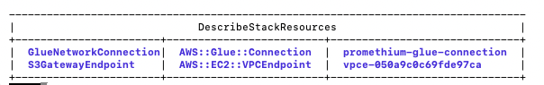

# Private S3 Access for Trino + Glue Crawlers

Documentation and the CloudFormation template that let Promethium's Trino and Glue crawlers reach an S3 bucket over a private VPC path. The bucket may be in the **same** AWS account as the Promethium (IE) deployment or in a **different** account; access is granted by the bucket policy to the compute account's IAM roles. This setup ensures:

1. No traffic to S3 goes over the public internet (via S3 Gateway VPC endpoint).
2. Access is restricted by VPC endpoint, IAM, and bucket policy.
3. Promethium's S3 access is scoped to the target bucket and the Glue crawler's operational permissions (not account-wide).

## Overview
The IE Trino pod (via IRSA) and Glue crawlers share the same private path:

Trino (EKS pod via IRSA) → HTTPS (private) → VPC route tables → S3 Gateway VPC Endpoint → Amazon S3

Glue crawlers use the same VPC path but additionally need:
- A Glue network connection: places crawler ENIs in your VPC
- A private subnet + security group
- Permission to create Elastic Network Interfaces (ENIs)

## Prerequisites
Before running the template you must already have:

- **VPC ID** used by the IE deployment.
- **Private subnet(s)** for the EKS workloads and the Glue connection (and their AZs).
- **Route table(s)** associated with those private subnets: the S3 Gateway endpoint is attached to these, so workloads route to S3 through it.
- **Security group** that allows outbound HTTPS (TCP 443). For the Glue network connection, it must also contain a **self-referencing inbound rule** (all TCP, from itself) so Glue can establish its ENIs.
- **Same region:** the S3 Gateway endpoint and the **target bucket must be in the same AWS region**. Gateway endpoints are regional and do not serve buckets in another region. For a cross-region bucket, co-locate it or use an S3 **interface** endpoint instead (contact Promethium for support).
- **IAM roles** — a Trino IRSA role and a Glue crawler role, configured per [IAM setup](#iam-setup) below.

## IAM setup
Two IAM roles are involved. `<compute-account-id>` is the account where the IE/EKS runs; the bucket may be in that account or another.

**1. Trino IRSA role** (the role the Trino pod assumes, e.g. `promethium-<env>-<tenant>-trino-oidc-role`)
- Needs `s3:ListBucket` + `s3:GetObject` on the target bucket (granted both in its identity policy and in the bucket policy below).
- For **write-back** workloads, also needs `s3:PutObject` + `s3:DeleteObject` (see [(Optional) Write access](#optional-write-access)).

**2. Glue crawler role** (the role Promethium passes to AWS Glue as the crawler role; this may be a dedicated role or, preferably, the Trino IRSA role)
- **Trust policy** must allow AWS Glue to assume it (in addition to any existing OIDC/IRSA trust if it is the Trino role):
  ```json
  { "Effect": "Allow", "Principal": { "Service": "glue.amazonaws.com" }, "Action": "sts:AssumeRole" }
  ```
- **Attach the AWS-managed policy** `arn:aws:iam::aws:policy/service-role/AWSGlueServiceRole` — it grants the Glue-service permissions a crawler needs: CloudWatch Logs (`logs:*` under `/aws-glue/*`), EC2 ENI management (for the network connection), Glue catalog access, and `glue:GetConnection`.
- **S3 access to the target bucket** (identity policy):
  ```json
  { "Effect": "Allow", "Action": ["s3:ListBucket", "s3:GetObject"],
    "Resource": ["arn:aws:s3:::<bucket-name>", "arn:aws:s3:::<bucket-name>/*"] }
  ```

**3. PassRole** — the identity that creates/starts crawlers (Promethium's glue service, via its IRSA role) must be allowed to pass the crawler role to Glue:
```json
{ "Effect": "Allow", "Action": "iam:PassRole",
  "Resource": "arn:aws:iam::<compute-account-id>:role/<glue-crawler-role>" }
```
> If `GLUE_CRAWLER_ROLE` is the Trino IRSA role itself, that one role needs the Glue trust statement, `AWSGlueServiceRole`, the S3 access, **and** `iam:PassRole` on itself.

## Setup
To establish the private VPC path, provision these two resources in the AWS deployment where the IE is installed:

- **S3 Gateway VPC Endpoint** — attached to the route table(s) used by your workload (private) subnets. Optionally apply a restrictive endpoint policy (limit to specific buckets).
- **Glue NETWORK Connection** — bound to a **private subnet whose route table carries the S3 Gateway endpoint**, ensuring crawler traffic through the endpoint, and to the security group above. The subnet determines the connection's AZ.

### Deployment

`AWS/utilities/install_vpc_endpoint.sh` wraps the CloudFormation call with automated waiting and reporting.

> **Naming:** the **stack name** and the **Glue connection name** are each unique per AWS account per region — pick names not already in use (e.g. suffix with your tenant/env). Re-running with an existing name fails fast.
> **Region:** `AwsRegion` and `--region` must be the region of the **target bucket** (see same-region prerequisite).

```bash
./AWS/utilities/install_vpc_endpoint.sh \
  --region us-east-1 \
  --stack-name s3-cross-account-permissions-<tenant> \
  --template-file AWS/CFT/s3-private-crawler/promethium-vpc-s3-glue-connection.yaml \
  --parameters \
    VpcId=vpc-xxxxxxxxxxxxxxxxx \
    RouteTableIds=rtb-xxxxxxxxxxxxxxxxx \
    SubnetId=subnet-xxxxxxxxxxxxxxxxx \
    AvailabilityZone=us-east-1b \
    SecurityGroupIds=sg-xxxxxxxxxxxxxxxxx \
    AwsRegion=us-east-1 \
    AddEndpointPolicy=false \
    AllowedBucketArns='' \
    GlueConnectionName=promethium-glue-connection-<tenant> \
    GlueConnectionDescription="Glue network connection for Promethium crawler"
```
After the stack is created, note the **VPC endpoint ID** from the outputs, for the bucket policy, and the **Glue connection name**.



The script prints creation progress, lists the created resources on success, and reports failure reasons (exits non-zero) if the stack fails.

> **Changing parameters:** the script uses `create-stack`, which does **not** update an existing stack. To change any parameter, delete the stack and recreate it:

```bash
./AWS/utilities/install_vpc_endpoint.sh \
  --region us-east-1 \
  --stack-name s3-cross-account-permissions-<tenant> \
  --delete-stack
```

## Post-deployment

### 1. Bucket policy
Grant **both** the Trino IRSA role and the Glue crawler role access to the bucket, restricted to requests arriving through the VPC endpoint. This example grants **whole-bucket, read-only** access, which matches how Promethium catalogs a data source (each folder becomes a table); scope it down with an `s3:prefix` condition only if you intend to expose a single prefix. For write-back workloads, add the opt-in statement in [(Optional) Write access](#optional-write-access) below.

```json
{
  "Version": "2012-10-17",
  "Statement": [
    {
      "Sid": "AllowListBucketViaVpcEndpoint",
      "Effect": "Allow",
      "Principal": {
        "AWS": [
          "arn:aws:iam::<compute-account-id>:role/<trino-oidc-role>",
          "arn:aws:iam::<compute-account-id>:role/<glue-crawler-role>"
        ]
      },
      "Action": "s3:ListBucket",
      "Resource": "arn:aws:s3:::<bucket-name>",
      "Condition": {
        "StringEquals": { "aws:SourceVpce": "<vpc-endpoint-id>" }
      }
    },
    {
      "Sid": "AllowGetObjectViaVpcEndpoint",
      "Effect": "Allow",
      "Principal": {
        "AWS": [
          "arn:aws:iam::<compute-account-id>:role/<trino-oidc-role>",
          "arn:aws:iam::<compute-account-id>:role/<glue-crawler-role>"
        ]
      },
      "Action": "s3:GetObject",
      "Resource": "arn:aws:s3:::<bucket-name>/*",
      "Condition": {
        "StringEquals": { "aws:SourceVpce": "<vpc-endpoint-id>" }
      }
    }
  ]
}
```

> **If the Trino and crawler roles are the same role**, list it once.
> **SSE-KMS buckets:** if the bucket is encrypted with a customer-managed KMS key, also grant both roles `kms:Decrypt` (and `kms:GenerateDataKey` for writes) on the key, and add them as principals in the **KMS key policy** — a cross-account key requires both. Buckets using SSE-S3 (AES256) need no extra KMS setup.

#### (Optional) Write access
The policy above is **read-only** (`s3:ListBucket` + `s3:GetObject`). If you run **Promethium pipelines targeting this bucket**, add the statement below to the `Statement` array. Grant it only to the role(s) that actually write — typically the **Trino role**.

```json
{
  "Sid": "AllowPutObjectViaVpcEndpoint",
  "Effect": "Allow",
  "Principal": {
    "AWS": "arn:aws:iam::<compute-account-id>:role/<trino-oidc-role>"
  },
  "Action": [
    "s3:PutObject",
    "s3:DeleteObject",
    "s3:AbortMultipartUpload",
    "s3:ListMultipartUploadParts"
  ],
  "Resource": "arn:aws:s3:::<bucket-name>/*",
  "Condition": {
    "StringEquals": { "aws:SourceVpce": "<vpc-endpoint-id>" }
  }
}
```

- The writing role's **identity policy** must also allow these actions. The Promethium Trino role grants S3 writes by default; a custom/dedicated role needs `s3:PutObject` + `s3:DeleteObject`.
- For a **cross-account** bucket this bucket-policy statement is **required** for writes — a cross-account write must be allowed by *both* the caller's identity policy and the bucket policy, so a read-only bucket policy blocks writes even when the identity policy permits them.
- For **SSE-KMS** write targets, also grant `kms:GenerateDataKey` on the key (see the SSE-KMS note above).

### 2. Wire the connection into the Glue crawler deployment
Set these environment variables on the `glue-crawler` deployment so Promethium attaches the connection to the crawlers it creates:

```
GLUE_USE_VPC_CONNECTION=true
GLUE_VPC_CONNECTION_NAME=<connection name from the stack output>
```

Set them through whatever manages that deployment (Helm values, your GitOps source, etc.). For GitOps-managed clusters, set them in the source of truth — an imperative `kubectl set env` is reverted on the next reconcile. Example for a directly-managed cluster:

```bash
kubectl set env deployment/glue-crawler \
  GLUE_USE_VPC_CONNECTION=true \
  GLUE_VPC_CONNECTION_NAME="<connection name from above step>" \
  -n intelligentedge
```

## Template location
See `promethium-vpc-s3-glue-connection.yaml` in this folder for the CloudFormation template that provisions the endpoint and Glue connection resources.
